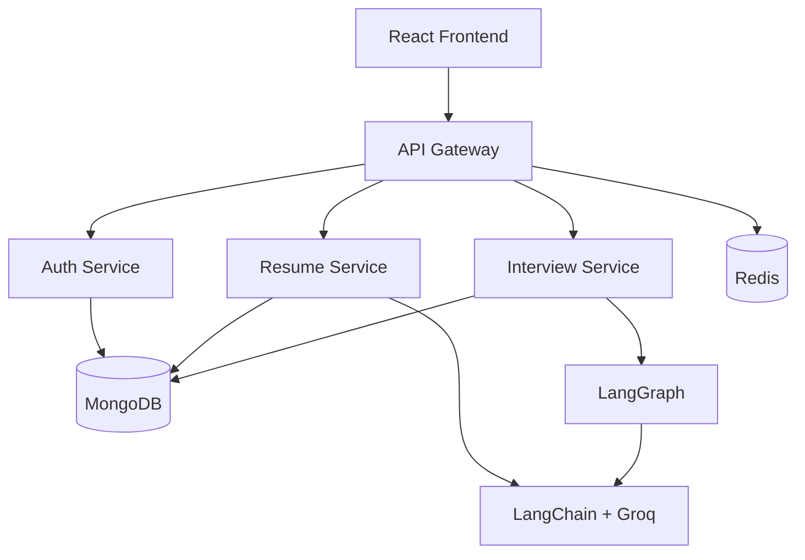

# AI Interview Platform

An AI-powered platform that helps users prepare for job interviews through personalized interview practice, resume analysis, and AI-generated feedback.

## ✨ Features

- **AI Interview:** Generate personalized technical and HR interview questions.
- **Resume Analyzer:** Upload a PDF resume and receive AI-powered analysis.
- **AI Feedback:** Get feedback, strengths, weaknesses, and improvement suggestions.
- **Interview Reports:** Review interview performance and results.

## 🛠️ Tech Stack

| Category | Technologies |
|---|---|
| Frontend | React, TypeScript, Tailwind CSS, Motion |
| Backend | Node.js, Express.js, Microservices |
| Database | MongoDB, Redis |
| Authentication | Firebase Authentication |
| AI | LangChain, LangGraph, Groq |
| DevOps | Docker |

## 🏗️ Architecture

The application uses a microservices architecture with an API Gateway to route requests to individual backend services.



## 🚀 Getting Started

**Prerequisites:** Node.js, npm, Docker, MongoDB, Firebase credentials, and a Groq API key.

1. Clone the repository:

```bash
git clone https://github.com/PREM-xd/AI-Interview.git
cd AI-Interview
```

2. Install dependencies in the frontend, gateway, and each backend service.

3. Configure the required `.env` files.

4. Start Redis:

```bash
cd backend
docker compose up -d
```

5. Start the backend services and frontend in separate terminals using their development scripts.

## 🔮 Future Improvements

- AWS deployment
- Automated testing
- CI/CD pipeline
- Improved monitoring and scalability
